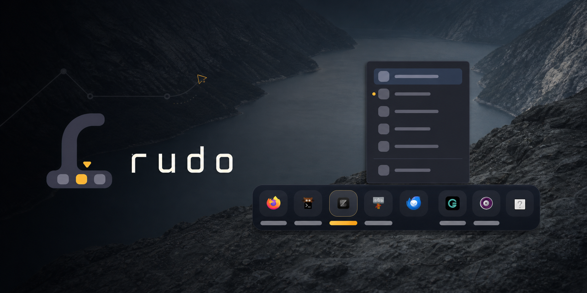

# rudo



A small, elegant dock for Wayland. 

`rudo` keeps your desktop clean with pinned apps, live window tracking, gentle autohide, and easy configuration. It feels right at home on `niri`, but plays nicely with other Wayland compositors that support the right protocols.

## Features

*   **Wayland-first:** Built with GTK4 and layer-shell.
*   **Smart tracking:** Persistent pinned apps and live running windows.
*   **Quality of life:** Launch feedback (no more double-click spam), optional hover-to-reveal autohide, and manual CLI toggles (`--toggle`, `--show`, `--hide`).
*   **Customizable:** CSS theming, live-reloading JSON settings, and multi-monitor support.
*   **Power menu:** Configurable menu for custom actions, system commands, and destructive confirmations.

## Compositor Support

*   **niri:** The best experience, utilizing `NIRI_SOCKET`.
*   **Other Wayland compositors:** Works well via `wlr-foreign-toplevel-management`. 

Both backends fully support window tracking, activation, and closing.

## Installation & Running

**Arch Linux (AUR):**
The easiest way. This grabs the pre-built binary, so no compilation is needed.
```bash
yay -S rudo-bin # or paru -S rudo-bin
```

**From Source:**
You'll need `gtk4`, `gtk4-layer-shell`, and `pkgconf` (e.g., `sudo pacman -S gtk4-layer-shell pkgconf gtk4`).

```bash
cargo run --release
# or if you use just:
just run
```

Running `rudo` multiple times won't spawn duplicate docks; it just reuses the existing one. You can easily bind visibility controls to your compositor's hotkeys:
```bash
rudo --toggle
rudo --show
rudo --hide
```

## Configuration

Rudo stores its config in `~/.config/rudo/`:
*   `pins.json`: Your pinned apps.
*   `settings.json`: Behavior and layout.
*   `style.css`: Visual CSS overrides (loaded on startup, no rebuild needed).

Here’s a look at `settings.json`:

```json
{
  "autohide": { "enabled": true, "delay_secs": 3 },
  "show_pin_button": true,
  "icon_size": 24,
  "position": "bottom",
  "outputs": "first",
  "window_scope": "all",
  "animation_duration_ms": 220,
  "menu": {
    "enabled": false,
    "icon": "system-lock-screen-symbolic",
    "position": "end",
    "items": [
      {"label": "Lock", "icon": "system-lock-screen-symbolic", "command": "swaylock -f", "confirm": false},
      {"label": "Shutdown", "icon": "system-shutdown-symbolic", "command": "systemctl poweroff", "confirm": true}
    ]
  }
}
```

*   **position**: `"bottom"`, `"top"`, `"left"`, or `"right"`.
*   **outputs**: `"first"` (one dock) or `"all"` (one dock per monitor).
*   **window_scope**: `"all"` (default: windows from every monitor) or `"current_monitor"` (only windows on each dock's monitor). Pins stay visible everywhere; running indicators and window actions use the filtered list.
*   **menu**: Add custom actions or a power menu. Set `"confirm": true` for destructive commands so you don't accidentally reboot!

Settings and monitor changes apply automatically while Rudo is running. Per-monitor filtering uses Niri workspace/output information or Wayland toplevel output membership. Windows spanning multiple outputs appear on each matching dock. If a window's output or the dock's monitor cannot be identified, Rudo keeps those windows visible rather than hiding them; older compositors without output names may therefore show a global list.

### App Recognition

Rudo matches running windows to desktop entries using desktop IDs, `StartupWMClass`, Flatpak IDs, and executable names. 

If an app (like Obsidian or a generic Electron app) shows up as a blank/generic icon:
1.  Make sure it has a proper `.desktop` file in your application menu. AppImages usually need one in `~/.local/share/applications/`.
2.  Check the app's actual window ID (e.g., `niri msg windows` in Niri).
3.  Add `StartupWMClass=the_actual_id` to its `.desktop` file.

Rudo doesn't guess apps from window titles, so you might need to explicitly tell it how to recognize apps that share generic IDs.

## Autostart (niri)

**Using systemd (Recommended for AUR):**
```bash
systemctl --user enable --now rudo.service
```
*(If installed manually, copy the binary and `rudo.service` to their proper `/usr/local/bin` and `~/.config/systemd/user/` locations first, then run `systemctl --user daemon-reload`)*.

**Using niri config:**
Alternatively, just spawn it directly in your niri config:
```kdl
// ~/.config/niri/config.kdl
spawn-at-startup "rudo"

binds {
    Mod+D { spawn "rudo" "--toggle"; }
}
```
*Note: If you use the systemd service, remove any `spawn-at-startup "rudo"` lines from your niri config to avoid duplicates.*

## Development & Status

```bash
just fmt
just check
cargo test --all-targets
```

CI handles formatting, strict Clippy lints, and tests (which use temp desktop entries and don't need a live GUI).

`rudo` is intentionally small and focused. The codebase is kept clean so it's easy to hack on and extend as new dock features are added.
